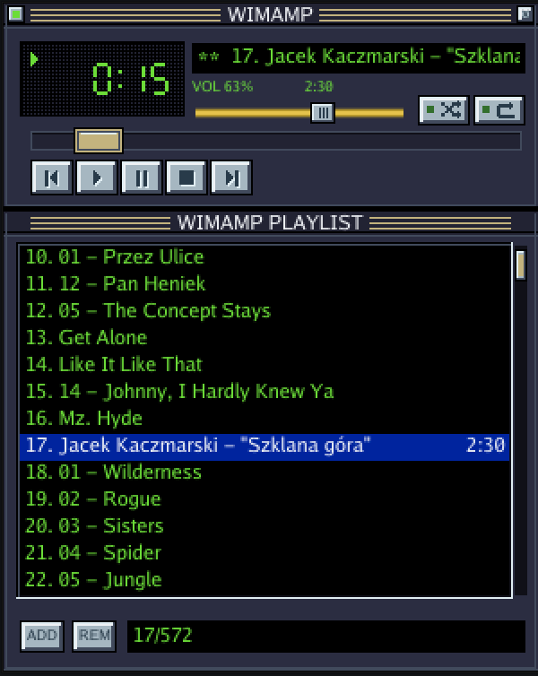

# Wimamp

[](https://github.com/wimcraft/wimamp/actions/workflows/ci.yml) [](https://github.com/wimcraft/wimamp/releases) [](LICENSE)

A keyboard-first music player for local files, in the spirit of Winamp. One small binary with a CLI, a TUI with vim keys, and a Winamp-style popup window you can summon with a hotkey. Playback is done by [mpv](https://mpv.io), which wimamp starts in the background on first use, so anything that can run a command (Raycast, Hammerspoon, i3, AutoHotkey, a status bar) can control it. No accounts, no streaming, no library database: files, folders and `.m3u` playlists.

<p align="center"></p>

The popup uses a 300 × 374-point classic-inspired layout with beveled silver controls, striped title bars, and a green display. The crossing-arrows button toggles shuffle; the return-arrow button toggles repeat. Drag the playlist scrollbar to browse without changing the selected track. The pin button at the left of the title bar keeps the window on top and open when you click elsewhere.

macOS is the primary platform. Linux and Windows builds are published too, but they get less testing.

## Install

wimamp needs mpv:

```sh
brew install mpv                       # macOS
sudo apt install mpv                   # Debian/Ubuntu
winget install -e --id shinchiro.mpv   # Windows
```

Then install wimamp. On macOS and Linux it goes into `~/.local/bin`:

```sh
curl -fsSL https://raw.githubusercontent.com/wimcraft/wimamp/main/install.sh | sh
```

On Windows, run this in PowerShell. It installs into `%LOCALAPPDATA%\Programs\wimamp` and adds that folder to your user PATH:

```powershell
irm https://raw.githubusercontent.com/wimcraft/wimamp/main/install.ps1 | iex
```

Run the same command again to update. Both scripts pick the binary for your system from the [latest release](https://github.com/wimcraft/wimamp/releases/latest) and check its SHA-256. `WIMAMP_VERSION=v0.1.0` pins a version (in PowerShell: `$env:WIMAMP_VERSION = "v0.1.0"`), and `WIMAMP_INSTALL_DIR` changes the target directory.

To build from source (Go 1.27+; on Linux the window also needs the X11/GL headers, e.g. `libgl1-mesa-dev xorg-dev`):

```sh
go install github.com/wimcraft/wimamp@latest
```

## Use

```sh
wimamp add ~/Music/Album     # queue a folder (searched recursively) or files
wimamp play                  # start; `wimamp play <paths>` replaces the queue
wimamp toggle                # play/pause - bind this to a hotkey
wimamp next | prev | stop | pause
wimamp seek -10 ; wimamp vol +5
wimamp status                # ▶ Title  1:05 / 3:20  vol 80%   (for status bars)
wimamp save evening ; wimamp load evening ; wimamp playlists
wimamp                       # TUI
wimamp gui                   # popup window
wimamp quit                  # stop the background player
```

Closing the TUI or the window leaves the music playing. The popup window closes on Esc, `q`, or when it loses focus, and only one can be open at a time. On macOS, closing only hides it: the window process stays in the background (no Dock icon, no CPU), so the next `wimamp gui` shows it almost instantly. The first one takes about half a second. `wimamp quit` ends it along with the player.

## Keys

The same keys work in the TUI and the window. Press `?` in either one, or run `wimamp keys`, to see every action with its current keys.

| Action | Keys | Action | Keys |
|---|---|---|---|
| down / up | `j` `k` | play selected | `enter` |
| top / bottom | `gg` / `G` | prev / play / pause / stop / next | `z` `x` `c` `v` `b` |
| half page | `ctrl+d` / `ctrl+u` | toggle pause | `space` |
| jump to playing | `o` | next / prev | `n` / `p` |
| seek ±5 s | `l` / `h` | stop | `s` |
| volume | `+` / `-` | remove selected | `dd` |
| shuffle / repeat | `S` / `r` | add files / folder (window) | `a` / `A` |
| search, jump to track | `/` `ctrl+j` | key help | `?` |
| close | `q` (window: also Esc) | quit the player | `Q` |

Search filters the playlist as you type, by name or folder. Names containing the query come first, then fuzzy matches. Use `up`/`down` or `ctrl+n`/`ctrl+p` to pick a match, `enter` to play it, and Esc to cancel. In the window, `ctrl+m`, `ctrl+i`, `ctrl+h` and `ctrl+[` work as Enter, Tab, Backspace and Esc, as they do in a terminal.

To rebind, create `keys.conf` in the config directory (`wimamp configdir` prints it). Listing an action replaces its default keys, and an empty list unbinds it:

```
# action = keys
next = J n
prev = K p
remove =
```

## Hotkeys

Wimamp has no global hotkeys of its own; bind the CLI in your tool of choice.

```lua
-- Hammerspoon
hs.hotkey.bind({"cmd", "alt"}, "space", function() hs.execute("wimamp toggle", true) end)
hs.hotkey.bind({"cmd", "alt"}, "w", function() hs.execute("wimamp gui", true) end)
```

```
# i3
bindsym $mod+p exec wimamp toggle
bindsym $mod+w exec wimamp gui
```

```autohotkey
; AutoHotkey v2
^!Space::Run "wimamp toggle",, "Hide"
^!w::Run "wimamp gui",, "Hide"
```

Raycast: create a Script Command and assign it a hotkey. Raycast's PATH lacks Homebrew, so add it for mpv, and detach the window so Raycast doesn't wait for it:

```bash
#!/bin/bash
# @raycast.schemaVersion 1
# @raycast.title Wimamp
# @raycast.mode silent
export PATH="$HOME/.local/bin:/opt/homebrew/bin:$PATH"
nohup wimamp gui >/dev/null 2>&1 &
```

## macOS: no sound when started from some apps

The background player belongs, for macOS privacy purposes, to the app it was first started from. If that app (a terminal, for example) was never allowed the microphone access CoreAudio asks about, mpv plays silently. Allow the app under System Settings → Privacy & Security → Microphone, or run `wimamp quit` and start the player from another app.

## Files

- Socket: `$XDG_RUNTIME_DIR` or the user cache directory (`wimamp-<uid>.sock`), or the named pipe `\\.\pipe\wimamp` on Windows. Override it with `WIMAMP_SOCKET`.
- Config: `$XDG_CONFIG_HOME/wimamp`, `~/.config/wimamp`, or `%AppData%\wimamp`. It holds `keys.conf` and `playlists/*.m3u`.
- Your own `mpv.conf` still applies (audio output, replaygain, …).

## Design

The behavior is specified with [OpenSpec](https://github.com/Fission-AI/OpenSpec) in [`openspec/specs`](openspec/specs), one spec per capability (daemon, CLI, playlists, keybindings, TUI, search, popup window), and the design decisions with their trade-offs are in [`openspec/changes/archive`](openspec/changes/archive).

## License

[MIT](LICENSE)
